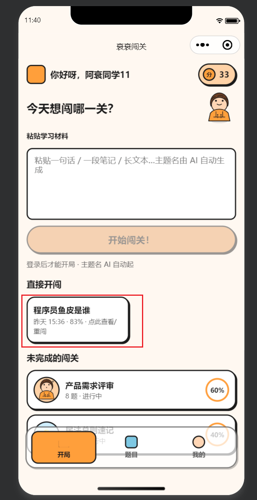

# Bug修复

# 1.梳理Bug

先清除所有的缓存，从0开始一个一个页面和功能依次进行测试和梳理Bug\(先记录下来\)，记得同时打开小

程序的网络控制台，便于观察界面无法直接看出的错误。

1）现象：引导页结构太居中

预期：应该像原型图一样，上下结构，开整按钮应该置于底部，按钮上方区域应该在标题导航栏下方，按钮和上方内容中间应该有距离

2）现象：输入框中没有内容，按钮是置灰状态，但是仍然能够点击给出提示给用户

预期：无论输入框中是否有内容，按钮都不置灰，如果输入框没有内容，用户点击则提示用户

3）现象：首页上方导航栏你好呀，前面的头像没有展示

预期：应该展示用户的头像，并且用户修改头像后应该同步更新

4）现象：有多余的提示

预期：删除多余的提示

5）现象：页面滚动时，最下方的内容被底部tabbar挡住

预期：页面整体内容应该和底部tabbar有一个安全的距离，不被tabbar挡住内容，每个tabbar页面都有这个问题，需要同步解决

6）现象：直接开闯的内容展示的不符合预期

预期：标题下面的内容应该展示（正确率：xx% · x（x是题目数量）题，然后换行展示4个字（直接开闯）

7）现象：底部tabbar切换时，对应的svg图标模糊看不清

预期：在切换底部tabbar的时候，svg仍然能够看清，可以使用选中时的样式和未选中时的样式进行区分，剩下的两个tabbar按钮也是同理

8）现象：题库页中的每个框之间的距离太小，框内的4周padding值也太小，前面的图标太单调

预期：框内4周的padding值加到30rpx差不多，每个框之间的间距也略加大一点，前面的图片可以选则题目标题的第一个字作为内容放入到颜色框中，显得不单调

9）现象：我的页面的头部展示用户信息的位置和原型图不符，卡片的padding值也同样很小，卡片之间的距离也很小

预期：头像，昵称展示的内容是没有卡片框的，头像在略放大一点点，卡片中的padding值放大到30rpx，卡片之间的距离也略放大一点

10）现象：点击名称修改时，但还未正真修改就会直接弹出昵称已保存提示，点击使用微信昵称时，会一闪而过微信昵称，但是并没有真正的修改成功，使用的还是老数据。点击昵称修改时，没有显眼的修改标志，不明显

预期：点击名称修改时，在名称下方会出现一条下划线，让用户感知到目前是修改状态，等用户真正确定修改或用户点击其他位置，使状态不是修改时，才提示用户昵称已保存。并且用户点击使用微信昵称时，能够正确的修改为用户的微信昵称。

11）现象：闯关历史，有重复的导航展示，卡片的内边距太小

预期：去掉重复的导航提示，使用微信小程序自带的顶部导航栏提示和返回按钮，卡片的内边距略加大一点，如果有多个卡片，多个卡片之间的间距不能太挤

12）现象：历史闯关详情页面嵌套有点多余

预期：点击闯关历史后应该直接展示历史报告页面的内容（也就是主流程中答题完毕后生成的报告页面），不需要有主题详情页在跳转到看复盘报告页，而且复盘报告页应该直接使用历史报告页，页面展示内容应该和首次生成的报告页面一致。

13）现象：历史报告页面展示的内容不全，正确率图标有问题，答对，答错太单调，且太大，下方卡片的间距太小，挨在一起了，每个内容中的·符号太小不明显，错题回顾的判断图标背景太长，页面丢失生成海报并分享按钮，按钮之间的间距也太小，旧报告翻出来了和题目主题两者未换行与原型不符

预期：旧报告翻出来了和题目主题应该换行显示，正确率应该根据具体正确率值正确显示圆形的进度，答对，答错按钮缩小一点，正确率放大一点，答对背景用绿色，答错背景用红色，加大下方卡片的间距，让·符合更加的醒目，判断图标的背景正常显示，不需要返回按钮直接使用微信小程序顶部的返回键即可，补充生成海报并分享按钮，按钮之间的间距也要加大，不能挨在一起

14）现象：闯关页的顶部1/6和下方的第x题/共x题重复，且闯关页顶部行的积分被微信小程序的胶囊行挡住

预期：使用微信小程序自带的顶部导航栏，导航栏内容使用当前闯关的主题，如果展示不完则使用\.\.\.展示多余部分，中间的主题名\+图标删除，积分不能被胶囊挡住

15）现象：第x题/共x题和每道题目的内容在同一行，影响美观度，题目和选项直接的距离也小

预期：第x题/共x题下方有一个长的细的进度条展示答题进度，具体题目内容在进度条下方展示，加大一点题目和选项直接的距离

16）现象：知识讲解中重复说明正确答案：xxxx

预期：知识讲解只展示解析，不需要说明正确答案：xxxx，选项中的最终正确项会被选中

17）现象：答题闯关页的底部上一题和下一题按钮没有固定在底部，需要移动屏幕才能展示

预期：闯关页的底部上一题和下一题应该固定在页面底部，只有中间的答题区域和解析区域在屏幕放不下的时候可以滚动屏幕查看未展示的内容

18）现象：生成报告页的时候，在生成完毕的时候会先从报告加载页跳回到最后一题的答题页面，在跳转到报告页面

预期：生成报告完毕以后，应该直接从报告加载过渡页直接到报告页面

19）现象：通过报告页的通过！这局够味和闯关主题在同一行，和原型不符，并且鼓励词（通过！这局够味）太单调

预期：通过！这句够味应该和闯关主题内容换行展示，鼓励词应该跟本局表现动态展示不一样的内容，可以让模型生成或者说多列举几个鼓励词，然后根据本局的表现选择不同的鼓励词，两种方案你可以评估一下

20）现象：正确率进度条展示和实际正确率数据不符，答对答错卡片太单调，且太大

预期：正确率进度条和实际正确率数据相匹配，答对答错卡片缩小一点，答对卡片用绿色背景，答错卡片用红色背景，放大一点正确率的展示

21）现象：卡片之间的间距太挤

预期：加大卡片之间的间距

22）现象：知识要点，薄弱点，错题回顾的内容太多，·符合太小

预期：可以精简一下知识要点，薄弱点，错题回顾的内容但是所有点都要说到，是精简不是单纯减少，加大·符号，让·符合更加的醒目

23）现象：缺失生成海报并分享按钮，且按钮之间的间距太小

预期：补充上生成海报并分享按钮，加大按钮之间的间距

