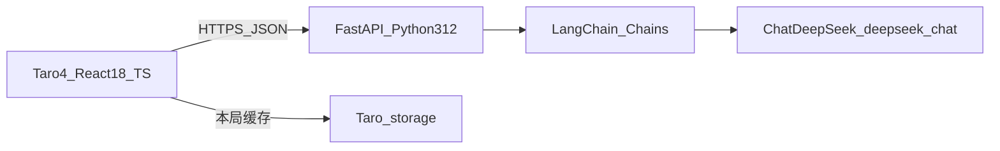
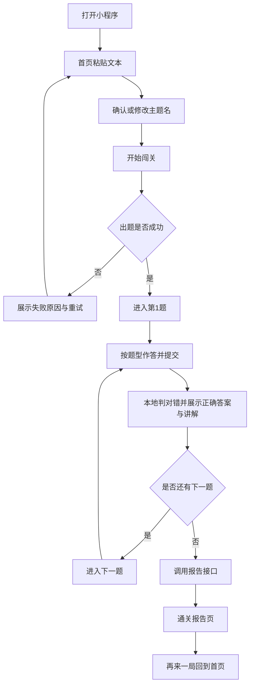
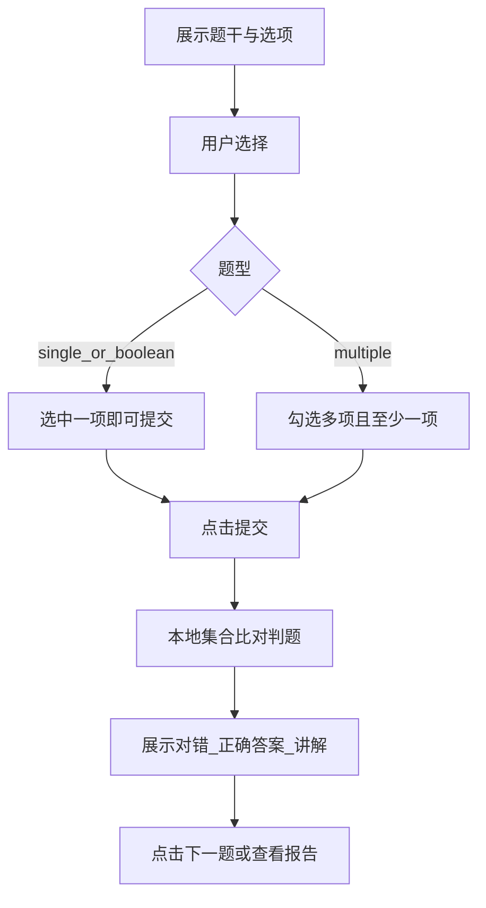

# 方案设计文档

> 产品暂定名：**任意知识闯关学习助手**  
> 形态：微信小程序｜市场：中国｜语言：默认中文  
> 依据：[`docs/需求分析文档.md`](./需求分析文档.md) v2.0  
> 版本：v1.0｜日期：2026-11-06  
> 说明：本文指导 Phase 0 开工实现；范围刻意小于需求文档完整 MVP，优先跑通核心业务链路。

---

## 0. 需求勘误与本期补充

| 项 | 需求文档口径 | 本期方案口径 |
|----|--------------|--------------|
| 题型 | 写为「选择题」 | **单选 / 多选 / 判断** 可在一局内混合出现 |
| 登录与历史 | MVP 含微信登录、学习历史、分享、重闯 | **本期不做**；后置到登录与持久化阶段 |
| 数据存储 | 学习数据与账号绑定 | **无数据库**；本局数据仅存小程序本地 Storage |
| 商业化 / RAG / 多输入 | 扩展项 | 本期不做 |

> 需求文档原文不改；题型与范围收敛以本文为准。后续若回写需求，可把「选择题」修订为「单选 / 多选 / 判断」。

---

## 1. 文档目标与成功标准

### 1.1 本期一句话目标

用户粘贴一段文本 → AI 生成混合题型闯关 → 逐题作答并即时讲解 → AI 生成通关复盘报告。  
**不依赖登录、注册、云数据库。**

### 1.2 本期成功标准

| 标准 | 含义 |
|------|------|
| 主路径可跑通 | 开发者工具或真机预览下，一人可完整走完输入→出题→答题→报告 |
| 题目结构合法 | 返回 JSON 经 Pydantic 校验；三种题型字段与判题规则正确 |
| 讲解必出 | 无论对错都展示正确答案与 explanation |
| 密钥不泄露 | DeepSeek API Key 仅存服务端，小程序不直连大模型 |

### 1.3 本期明确不做

- 微信登录 / 用户体系 / 云数据库 / 学习历史持久化
- 微信分享卡片、重闯、中断续玩
- 文档 / 网页 / 视频输入、RAG、VIP、排行榜、PK

---

## 2. 技术选型

### 2.1 小程序前端选型对比（重点）

| 维度 | 微信原生 | uni-app (Vue3) | **Taro 4.x (React)** | 微信云开发前端直调 AI |
|------|----------|----------------|----------------------|------------------------|
| 语法体验 | WXML + 自有组件模型 | Vue | **React 18 + TS** | 与前端框架无关 |
| 性能 | 最优，无编译层 | 良好，有运行时 | 良好，编译优化后接近原生 | — |
| 微信新能力跟进 | 最快 | 有滞后 | 有滞后，可用条件编译补 | 最快绑定云能力 |
| 多端扩展 | 弱 | 强 | **强**（后期可出 H5 等） | 绑定微信 |
| 一人全栈效率 | 需学小程序专有语法 | 需 Vue 栈 | **与常见 React/TS 一致** | 省后端但绑平台 |
| 与自建 FastAPI | 需自封装 request | 同左 | **同左，生态熟悉** | 不走自建后端 |
| 调试链路 | 最短 | 中等 | 中等（需编译到 weapp） | 短 |

**定稿：Taro 4.x + React 18 + TypeScript，编译目标仅 weapp。**

定稿理由：

1. 已明确采用 React/TS 技术栈，Taro 可直接复用组件化与类型体系。
2. 本期只打微信一端，但保留后续多端可能，避免过早锁死原生。
3. 后端已定为自建 FastAPI + DeepSeek，不走云开发 AI 主路径，前端无需绑定 CloudBase。

不选理由（简述）：

- **原生**：新能力最快，但与 React 习惯不一致，一人切换成本更高。
- **uni-app**：更偏 Vue；本项目不选 Vue 栈。
- **云开发 AI 直调**：与「FastAPI + LangChain + DeepSeek」冲突；且个人主体上架「深度合成」类目限制更多。

**风险与应对**：Taro 对部分微信新 API 可能滞后 → 用条件编译或 `Taro.xxx` 封装；复杂问题回查微信原生文档对照。

### 2.2 后端与 AI 选型

| 组件 | 定稿 | 说明 |
|------|------|------|
| 语言 | **Python 3.12** | FastAPI 要求 `>=3.10`（支持至 3.14）；3.12 生态成熟、Windows 友好，作为项目锁定版本 |
| Web 框架 | **FastAPI** + `fastapi[standard]` | 自动 OpenAPI、Pydantic v2 校验、适合 AI 网关 |
| AI 编排 | **LangChain** + **langchain-deepseek** | `ChatDeepSeek` + `with_structured_output` |
| 模型 | **DeepSeek `deepseek-chat`** | 支持 tool calling / structured output；**禁用** `deepseek-reasoner` 做出题/报告（不支持结构化输出） |
| 密钥 | `.env` 中 `DEEPSEEK_API_KEY` | 仅服务端读取 |

### 2.3 依赖清单（工程初始化用，本文不执行安装）

```text
# backend（Python 3.12）
fastapi[standard]
langchain
langchain-deepseek
pydantic>=2.9,<3
python-dotenv

# frontend
Node >= 16.20（推荐 LTS）
@tarojs/cli@4.x
模板：React + TypeScript，编译类型 weapp
```

### 2.4 存储策略（无数据库）

| 位置 | 存什么 | 不存什么 |
|------|--------|----------|
| 小程序 `Taro.setStorageSync` | 当前局：主题、题目列表、作答、报告缓存 | 跨设备账号数据 |
| FastAPI 进程内存 | 无必须状态；接口无状态 | 用户档案、历史局 |
| 磁盘 / DB | 本期不使用 | — |

刷新小程序后可尝试从 Storage 恢复「未完成的一局」；**不承诺**跨设备、不承诺长期归档。

---

## 3. 总体架构与设计思路

### 3.1 架构图



### 3.2 设计思路（为何这样拆）

1. **密钥与合规边界**  
   小程序永不直连 DeepSeek（防 Key 泄露 + 规避 request 合法域名直连境外/第三方模型的复杂度）。一律经 FastAPI。

2. **结构化优先于自由文本**  
   出题与报告用 Pydantic Schema + LangChain `with_structured_output`。前端只渲染字段，禁止依赖「从 markdown 里抠 JSON」。

3. **判题在端上，讲解随题带出**  
   出题时每题已含 `answer_indexes` 与 `explanation`。用户提交后本地按题型判对错并展示讲解，**不额外调一次 LLM**。通关后再调报告链做复盘。

4. **先假数据后真模型**  
   先冻结 API 契约与三题型 UI，用 mock JSON 跑通页面；再换真实 LangChain 链。降低「模型不稳导致前端卡死」的耦合。

5. **材料优先**  
   Prompt 强制：题目与讲解尽量只依据用户输入文本，不擅自外扩百科。

6. **题型统一 Schema**  
   用 `type` + `answer_indexes` 一套模型覆盖单选 / 多选 / 判断，避免三套接口与三套页面逻辑分叉失控。

### 3.3 核心接口一览

| 方法 | 路径 | 作用 |
|------|------|------|
| GET | `/health` | 探活，打通前后端联调 |
| POST | `/api/v1/quiz/generate` | 根据文本生成主题名 + 题目列表 |
| POST | `/api/v1/report/generate` | 根据作答结果生成通关报告 |

---

## 4. 核心业务流程

### 4.1 Phase 0 主流程（无登录）



### 4.2 单题状态机



### 4.3 答题 UI 规则

| type | 交互 | 题干标识 |
|------|------|----------|
| `single` | radio，选一项后可提交 | 单选 |
| `multiple` | checkbox，至少选 1 项后可提交 | **多选**（必须可见） |
| `boolean` | 同单选；选项固定为 `正确` / `错误` | 判断 |

业务规则（对齐需求）：

- 材料优先；讲解必出；失败可解释（告知发生了什么、可如何重试）。
- 必须先看反馈，才能进入下一题（禁止无反馈连刷）。

---

## 5. 接口与数据模型

### 5.1 题目模型（三题型统一）

```ts
type QuestionType = 'single' | 'multiple' | 'boolean'

interface Question {
  id: string
  type: QuestionType
  stem: string
  options: string[]           // single/multiple: 3~4 项；boolean: 固定 ["正确","错误"]
  answer_indexes: number[]    // 0-based；single/boolean 长度=1；multiple 长度>=2
  explanation: string
}
```

对应 Python（示意）：

```python
from enum import Enum
from pydantic import BaseModel, Field, model_validator

class QuestionType(str, Enum):
    single = "single"
    multiple = "multiple"
    boolean = "boolean"

class Question(BaseModel):
    id: str
    type: QuestionType
    stem: str
    options: list[str] = Field(min_length=2)
    answer_indexes: list[int] = Field(min_length=1)
    explanation: str

    @model_validator(mode="after")
    def validate_by_type(self):
        n = len(self.options)
        if any(i < 0 or i >= n for i in self.answer_indexes):
            raise ValueError("answer_indexes out of range")
        if self.type == QuestionType.boolean:
            if self.options != ["正确", "错误"] or len(self.answer_indexes) != 1:
                raise ValueError("boolean must be 正确/错误 with one answer")
        if self.type == QuestionType.single and len(self.answer_indexes) != 1:
            raise ValueError("single needs exactly one answer")
        if self.type == QuestionType.multiple and len(set(self.answer_indexes)) < 2:
            raise ValueError("multiple needs at least two distinct answers")
        return self
```

### 5.2 出题接口

`POST /api/v1/quiz/generate`

**Request**

```json
{
  "source_text": "用户粘贴的学习材料……",
  "topic_name": "可选，用户已改的主题名",
  "question_count": 6
}
```

| 字段 | 规则 |
|------|------|
| `source_text` | 必填（trim 后非空即可）；**不设最短字数限制**；只要有内容即允许出题，由 AI 尽量生成对应题目 |
| `topic_name` | 可选；空则由模型生成 |
| `question_count` | 默认 6，建议范围 5～10 |

**Response**

```json
{
  "topic_name": "光合作用要点闯关",
  "questions": [ /* Question[] */ ]
}
```

**题型配比（Prompt + 校验）**：约 单选 50% / 多选 30% / 判断 20%；题量允许时三种尽量都出现；过少时至少含单选 + 判断。服务端校验失败则对模型 **重试 1 次**，仍失败则返回可读错误。

### 5.3 用户作答与本地判题

```ts
interface UserAnswer {
  question_id: string
  selected_indexes: number[]  // single/boolean 长度为 1
  is_correct: boolean         // 前端计算后写入本局记录
}
```

**判题规则（MVP 从严，不做部分分）**：

```ts
function isCorrect(answer_indexes: number[], selected_indexes: number[]): boolean {
  const a = [...new Set(answer_indexes)].sort((x, y) => x - y)
  const b = [...new Set(selected_indexes)].sort((x, y) => x - y)
  return a.length === b.length && a.every((v, i) => v === b[i])
}
```

- 单选 / 判断：选错即错。  
- 多选：多选、少选、错选均算错（集合必须完全相等）。

### 5.4 报告接口

`POST /api/v1/report/generate`

**Request（示意）**

```json
{
  "topic_name": "光合作用要点闯关",
  "source_text_excerpt": "材料摘要，可截断至前 N 字",
  "correct_count": 4,
  "wrong_count": 2,
  "accuracy": 0.6667,
  "items": [
    {
      "question_id": "q1",
      "type": "multiple",
      "stem": "……",
      "options": ["A", "B", "C", "D"],
      "answer_indexes": [0, 2],
      "selected_indexes": [0, 1],
      "is_correct": false,
      "explanation": "……"
    }
  ]
}
```

**Response**

```json
{
  "summary_points": ["要点1", "要点2", "要点3"],
  "accuracy": 0.6667,
  "correct_count": 4,
  "wrong_count": 2,
  "wrong_review": [
    {
      "question_id": "q1",
      "type": "multiple",
      "stem": "……",
      "brief_reason": "漏选了关键条件 C，误选了干扰项 B"
    }
  ],
  "weaknesses": ["对多条件并列关系掌握不稳", "易混淆相近概念"]
}
```

数值型正确率、对错题数以**服务端根据 items 重算为准**也可；前端可先算再传，服务端校验一致性。

### 5.5 错误响应约定

```json
{
  "error_code": "GENERATE_FAILED",
  "message": "出题失败，请稍后重试"
}
```

常见：`GENERATE_FAILED`、`REPORT_FAILED`、`UPSTREAM_TIMEOUT`。（不再使用 `TEXT_TOO_SHORT`：前端仅拦空输入，有内容一律交给出题；失败则直接失败态页。）

---

## 6. Prompt 设计（可参考完整示例）

### 6.1 调用参数建议

| 场景 | temperature | max_retries | 备注 |
|------|-------------|-------------|------|
| 出题 | 0.3 | 2（LangChain）+ 业务校验失败再调 1 次 | 结构化稳定优先 |
| 报告 | 0.4 | 同上 | 允许略活泼的鼓励语气 |
| 超时 | 建议 60～90s | — | 出题输出较长，前端需明确 loading |

模型：**仅** `deepseek-chat`。

### 6.2 出题 Prompt（完整示例）

**System**

```text
你是「任意知识闯关学习助手」的出题老师。你的唯一依据是用户提供的学习材料。

硬性规则：
1. 只根据材料出题与写讲解，不要引入材料未出现的关键事实或外部百科。
2. 题目语言为简体中文。
3. 一局内混合三种题型：single（单选）、multiple（多选）、boolean（判断）。
4. 题量必须等于用户指定的 N。配比尽量接近：单选约 50%、多选约 30%、判断约 20%；若 N 较小，至少包含单选与判断。
5. 每题必须包含：id、type、stem、options、answer_indexes、explanation。
6. single：options 为 3～4 个选项；answer_indexes 恰好 1 个下标（从 0 开始）。
7. multiple：options 为 3～4 个选项；answer_indexes 至少 2 个不重复下标；题干应能看出是多选。
8. boolean：options 必须恰好为 ["正确","错误"]；answer_indexes 恰好 1 个。
9. explanation 必须能在用户答对或答错时都讲清楚「为什么」，紧扣材料表述。
10. 若用户未给出主题名，生成一个简洁中文主题名（不超过 20 字）；若已给出，则沿用用户主题名。

字段含义示例（勿照抄内容，只学结构）：
- 单选：{"id":"q1","type":"single","stem":"……","options":["A","B","C","D"],"answer_indexes":[1],"explanation":"……"}
- 多选：{"id":"q2","type":"multiple","stem":"……（多选）","options":["A","B","C","D"],"answer_indexes":[0,2],"explanation":"……"}
- 判断：{"id":"q3","type":"boolean","stem":"……","options":["正确","错误"],"answer_indexes":[0],"explanation":"……"}

输出必须严格符合结构化 Schema，不要输出 Markdown 代码块或多余说明。
```

**Human**

```text
主题名（可能为空，空则请你生成）：{topic_name}
题量 N：{question_count}

学习材料：
---
{source_text}
---

请生成 topic_name 与 questions 列表。
```

### 6.3 报告 Prompt（完整示例）

**System**

```text
你是「任意知识闯关学习助手」的复盘老师。根据用户本局作答，生成结构化通关报告。

硬性规则：
1. 语气中性、鼓励，禁止羞辱或贬低用户。
2. summary_points：3～6 条，概括本局材料中应掌握的要点（可结合作答表现，但不编造材料没有的知识）。
3. weaknesses：1～4 条薄弱点简述；若全对，可写「本局掌握较均衡」类正向结论，仍给出可巩固方向。
4. wrong_review：仅针对答错的题；每项含 question_id、type、stem、brief_reason（说明错因，可引用正确选项含义，勿冗长）。
5. accuracy、correct_count、wrong_count 与输入统计保持一致，不要擅自改数。
6. 输出严格符合结构化 Schema，不要 Markdown 包裹。
```

**Human**

```text
主题：{topic_name}
正确率：{accuracy}
答对：{correct_count}；答错：{wrong_count}

材料摘要（可能截断）：
---
{source_text_excerpt}
---

逐题作答明细（JSON）：
{items_json}

请生成 summary_points、weaknesses、wrong_review，并回传 accuracy、correct_count、wrong_count。
```

---

## 7. LangChain 接入示意（非落盘代码）

```python
import os
from langchain_deepseek import ChatDeepSeek
from langchain_core.prompts import ChatPromptTemplate

# QuizPayload / ReportPayload 为与上文一致的 Pydantic 模型

llm = ChatDeepSeek(
    model="deepseek-chat",
    temperature=0.3,
    max_retries=2,
    api_key=os.environ["DEEPSEEK_API_KEY"],
)

quiz_prompt = ChatPromptTemplate.from_messages([
    ("system", QUIZ_SYSTEM),   # 见 6.2
    ("human", QUIZ_HUMAN),
])

quiz_chain = quiz_prompt | llm.with_structured_output(QuizPayload)

def generate_quiz(source_text: str, topic_name: str | None, n: int) -> QuizPayload:
    result = quiz_chain.invoke({
        "source_text": source_text,
        "topic_name": topic_name or "",
        "question_count": n,
    })
    # 此处再跑一遍业务校验；失败可更换轻微提示后重试 1 次
    return result
```

报告链同理：`temperature=0.4`，`with_structured_output(ReportPayload)`。

FastAPI 路由只做：参数校验 → 调 chain → 二次校验 → 返回 JSON / 错误码。

---

## 8. 前端信息架构（Taro）

### 8.1 页面

| 路径 | 职责 |
|------|------|
| `src/pages/home` | 一屏引导文案（可内嵌）+ 文本输入 + 主题名 + 开始；仅空输入提示，有内容即可提交出题 |
| `src/pages/quiz` | 进度（如 3/8）；按 type 渲染；提交→反馈→下一题 |
| `src/pages/report` | 正确率、对错数、要点总结、错题回顾（标注题型）、薄弱点；入口「再来一局」 |

可选：独立 `guide` 页；为减页数建议并入 `home` 首次展示。

### 8.2 工程与联调

```text
AI-learn/
  docs/
  frontend/          # Taro 4 + React 18 + TS
  backend/           # FastAPI + LangChain
```

- 初始化：`taro init` → 选 React、TypeScript、微信小程序。  
- 开发：`npm run dev:weapp`，用微信开发者工具打开 `frontend/dist`。  
- 请求：封装 `Taro.request`，baseURL 指向本地 FastAPI（开发阶段可在开发者工具勾选不校验合法域名）。  
- 本局缓存 key 建议：`current_session`（含 topic、questions、answers、report）。

### 8.3 体验底线

- 出题 / 出报告：明确 loading（文案如「正在根据你的材料出题…」）。  
- 输入：仅当未输入任何内容（空态）时提示；只要有内容即可开局，不做「文本过短」拦截。  
- 失败：出题/报告生成失败直接进入失败态页，展示 `message` + 重试按钮。  
- 多选未选任何项：禁止提交并提示「请至少选择一项」。  
- 空历史：本期无历史页；首页引导「粘贴内容开始闯关」即可。

---

## 9. 核心开发流程（分步实现）

严格按序，先核心链路，后体验，最后才考虑登录类依赖。

| 步骤 | 内容 | 完成定义 |
|------|------|----------|
| 1. 脚手架 | `backend` 起 FastAPI + `GET /health`；`frontend` Taro weapp 空页能预览 | 小程序能请求到 health |
| 2. 契约与 Mock | 冻结 OpenAPI / TS 类型；mock 一局含 **单选+多选+判断各 ≥1** | 前后端类型一致 |
| 3. 前端主路径 | home → quiz（假数据三题型判题+讲解）→ report（假数据） | 不连模型也能走完 UI |
| 4. 出题链 | LangChain + DeepSeek 真实出题；校验与重试 | 真材料可生成合法题目 |
| 5. 答题闭环 | 本地判题（含多选完全匹配）+ 反馈态 | 对齐业务规则 |
| 6. 报告链 | 真实报告生成与结果页绑定 | 通关可见结构化报告 |
| 7. 体验打磨 | loading、空输入提示、失败态与重试、文案 | 主路径无死胡同 |
| 8. 后置（本期不做） | 登录、DB 历史、分享、重闯 | 仅保留清单 |

### 9.1 建议联调顺序

1. 用 Postman / curl 先验 `/quiz/generate`。  
2. 前端改接真出题，报告仍 mock。  
3. 再接通报告。  
4. 真机预览检查 setData/渲染与长文本输入。

---

## 10. 个人主体、合规与安全

| 风险 | 说明 | 本期策略 |
|------|------|----------|
| 个人主体上架 | 「深度合成 / AI 问答」等类目对个人主体限制较多 | 以**开发者工具 + 真机预览**验证核心链路；正式上架与主体迁移后置评估 |
| API Key | 泄露即可被盗刷 | 仅服务端 `.env`；不进小程序包；不提交 Git |
| 用户粘贴内容 | 可能含隐私 | 本期不落库；日志禁止全文打印材料；必要时截断 |
| 费用 | DeepSeek 按 token 计费 | 限制题量上限、超时与重试次数；前端防连点 |

---

## 11. 与需求扩展的映射（防范围回潮）

| 优先级 | 需求扩展 | 与本期关系 |
|--------|----------|------------|
| P1 | 文档输入、续玩、错题重练、讲解点赞、好友同闯、题量档位 | 多数需存储或登录；档位可后期加请求字段 |
| P2 | 网页/视频、书架、补考副本、知识胶囊、双模式 | 输入与资产形态扩展 |
| P3 | RAG、全网取知、生图、排行榜、PK、VIP | 明确后置 |
| P4 | 语音读题、数字人 | 远期 |

本期唯一目标：验证「文本 → 混合题型闯关 → 讲解 → 报告」是否成立。

---

## 12. 验收对照（Phase 0）

相对需求核对清单的可交付子集：

- [ ] 文本粘贴开局（仅空输入提示；有内容即可出题；失败进失败态）
- [ ] 主题名可自动生成且可改
- [ ] 出题 loading / 失败可重试
- [ ] 生成含单选、多选、判断的中文题；每题含正确答案与讲解
- [ ] 逐题进度；先反馈再下一题
- [ ] 本地判题正确（多选完全匹配）
- [ ] 通关报告含要点、正确率、对错数、错题回顾、薄弱点
- [ ] 无登录、无云库亦可完整走通

---

*文档结束。开工时以本文技术栈与数据模型为准；需求完整 MVP 在核心链路验证后再补齐。*
