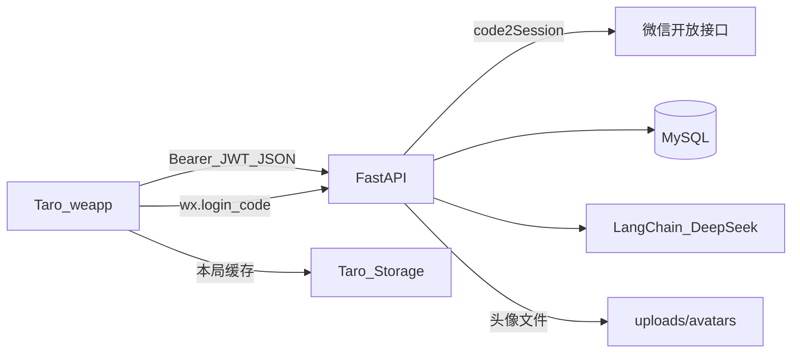
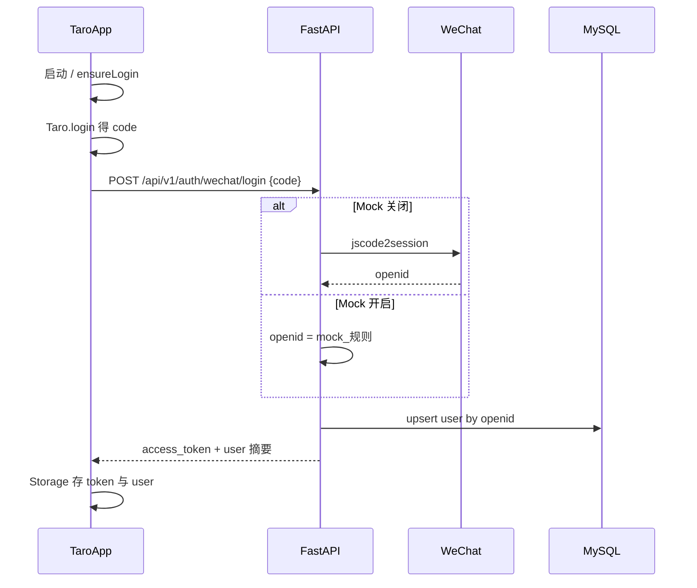
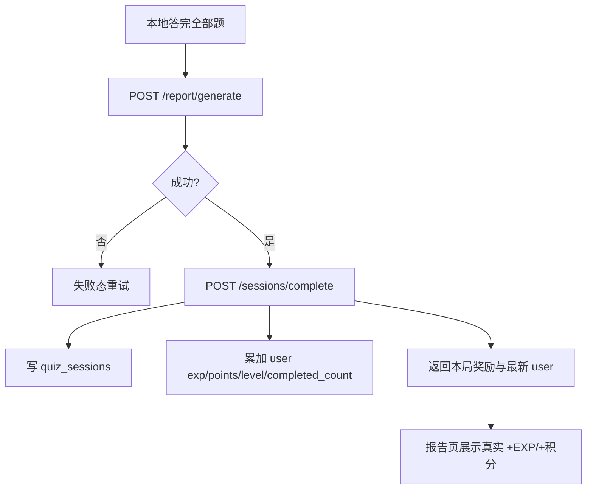

# 用户系统方案设计文档

> 产品名：**衰衰闯关**  
> 形态：微信小程序（Taro 4 + React 18 + TS）+ FastAPI + MySQL  
> 依据：[`docs/用户系统需求分析文档.md`](./用户系统需求分析文档.md) **v1.0**、[`UI原型/02-mvp-history-share.html`](../UI原型/02-mvp-history-share.html)、Phase 0 [`方案设计文档.md`](./方案设计文档.md)  
> 版本：v1.0（方案已确认）｜日期：2026-11-10  
> 说明：本文指导用户系统分批实现。方案已确认；**待 `.env` 填好并人工确认后再开发**。分享 / 游客 / 未完成云同步 / 积分兑换本期不做。

---

## 0. 与 Phase 0 的关系

| 项 | Phase 0 | 本期（用户系统） |
|----|---------|------------------|
| 登录 | 无 | 静默微信登录，强制登录后才能闯关 |
| 存储 | 仅小程序 Storage 本局缓存 | **MySQL** 持久化用户与已通关局 |
| 历史 / 重闯 / 成长 | UI 示意 | 真实接口 + 按原型裁剪 UI |
| 出题 / 报告 AI | 已有 | 保留；通关成功后增加「完成局入库 + 结算」 |
| 分享 | UI 示意 | **不做**（可保留无入口死代码，不接新入口） |

---

## 1. 目标与成功标准

### 1.1 一句话目标

用户打开小程序即静默登录 → 登录后方可闯关 → 通关写入 MySQL 并结算 EXP/积分/等级 → 可在「我的」完善资料、回看历史报告、打乱旧题重闯。

### 1.2 成功标准

| 标准 | 含义 |
|------|------|
| 静默登录 | 启动自动建立账号与 JWT；失败可重试；未登录不能出题 |
| 资料可选 | 默认「阿衰同学」；仅「我的」可改头像昵称 |
| 通关落库 | 仅已通关局入库；含题目快照、作答、报告、本局奖励 |
| 成长正确 | 按锁定公式结算；「我的」与历史展示一致 |
| 重闯 | 复用旧题、**仅打乱题目顺序**（不打乱选项），新局另记 |
| 密钥安全 | 微信 Secret / JWT Secret / DB 密码仅服务端 `.env` |
| 测试 | 后端用户相关逻辑均有 pytest（TDD）覆盖 |

### 1.3 明确不做

游客、分享海报/回流、未完成局入库、积分兑换、题库真功能、学习偏好配置。

---

## 2. 技术选型（本期增量）

| 组件 | 定稿 | 说明 |
|------|------|------|
| DB | **MySQL 8.x** | 需求指定；charset `utf8mb4` |
| ORM | **SQLAlchemy 2.x（同步）** | 与现有同步 FastAPI + LangChain 调用一致，降低一人维护成本 |
| 驱动 | **PyMySQL** | `mysql+pymysql://...` |
| 迁移 | **Alembic** | 表结构变更可回放 |
| 登录态 | **JWT（HS256）** | `Authorization: Bearer <token>`；建议 `PyJWT` |
| 微信 | `code2Session` | HTTP 调微信开放接口；`httpx` |
| 头像 | 本地上传目录 | 小程序选头像后 `uploadFile` 到后端，存相对 URL |
| 前端 | 现有 Taro 4 | `Taro.login` / Storage / 带 Token 的 `request` |

> 实现编码时：Taro 登录与头像组件用法须再对照微信开放文档 + Context7/Taro 文档，避免 API 过时。

### 2.1 新增依赖（示意）

```text
# backend 增量
sqlalchemy>=2.0
pymysql>=1.1
alembic>=1.13
PyJWT>=2.8
httpx>=0.27   # 已有，用于微信 code2Session
python-multipart  # 头像上传
```

### 2.2 环境变量（写入 `.env` / `.env.example`，人工填值）

```text
# 已有
DEEPSEEK_API_KEY=

# 微信小程序（人工填写）
WECHAT_APP_ID=
WECHAT_APP_SECRET=

# JWT
JWT_SECRET=                 # 随机长串，勿提交真实值
JWT_EXPIRE_DAYS=7

# MySQL
MYSQL_HOST=127.0.0.1
MYSQL_PORT=3306
MYSQL_USER=
MYSQL_PASSWORD=
MYSQL_DATABASE=ai_learn

# 开发辅助：无真实微信凭证时允许 Mock 登录（仅本地/测试）
WECHAT_MOCK_LOGIN=true
```

`WECHAT_MOCK_LOGIN=true` 时：跳过真实 `code2Session`，用稳定规则生成 `openid`（如 `mock_<code>`），便于开发者工具与 pytest；真机联调前改为 `false` 并填好 AppId/Secret。

---

## 3. 总体架构



### 3.1 设计原则

1. **身份与资料分离**：静默登录只解决 OpenID；昵称头像后置用户填写。  
2. **只存通关局**：出题/答题过程仍可走本地 Session；**报告成功后**一次性 `complete` 入库并结算。  
3. **判题仍在端上**：与 Phase 0 一致；入库保存最终作答与报告快照。  
4. **重闯不耗模型**：读历史题目快照 → 服务端打乱题目顺序 → 前端当新局作答 → 再 `complete`。  
5. **JWT 无状态**：退出登录只清客户端凭证；服务端不做黑名单（本期）。

---

## 4. 数据模型（MySQL）

### 4.1 `users`

| 字段 | 类型 | 说明 |
|------|------|------|
| id | BIGINT PK AI | 内部用户 ID |
| openid | VARCHAR(64) UNIQUE NOT NULL | 微信 OpenID |
| unionid | VARCHAR(64) NULL | 可选，预留 |
| nickname | VARCHAR(32) NOT NULL | 默认 `阿衰同学` |
| avatar_url | VARCHAR(512) NULL | 空则前端用默认头像 |
| exp | INT NOT NULL DEFAULT 0 | 累计经验 |
| points | INT NOT NULL DEFAULT 0 | 累计积分 |
| level | INT NOT NULL DEFAULT 1 | 可由 exp 推导，冗余便于展示 |
| completed_count | INT NOT NULL DEFAULT 0 | 累计通关局数 |
| created_at / updated_at | DATETIME | |

等级公式（与需求一致，写入服务时重算）：

- `level = floor(exp / 300) + 1`
- 等级内进度：`exp % 300` / `300`

### 4.2 `quiz_sessions`（仅已通关）

| 字段 | 类型 | 说明 |
|------|------|------|
| id | BIGINT PK AI | |
| user_id | BIGINT FK → users.id | |
| topic_name | VARCHAR(64) | |
| source_text | TEXT | 主题线索；重闯可带回展示，注意勿在日志打全文 |
| question_count | INT | |
| correct_count / wrong_count | INT | |
| accuracy | DECIMAL(5,4) | 0～1 |
| exp_gained / points_gained | INT | 本局结算 |
| questions_json | JSON | Question[] 快照（含答案与讲解） |
| answers_json | JSON | UserAnswer[] |
| report_json | JSON | ReportPayload |
| source_session_id | BIGINT NULL | 若由重闯产生，指向来源通关局 |
| finished_at | DATETIME | 通关时间 |
| created_at | DATETIME | |

索引：`(user_id, finished_at DESC)`。

> 未完成局不建表、不入库。本地 Storage 仍可暂存进行中的一局，杀进程后行为与 Phase 0 一致，**不承诺云续玩**。

---

## 5. 核心业务流程

### 5.1 静默登录



- 首页「开始闯关」：`ensureLogin()` 未成功则禁用或 toast。  
- 任意需登录接口 401：清本地 token → 自动再静默登录一次 → 失败则提示用户重试。

### 5.2 通关入库与结算



结算（单局只结算一次，幂等键可用客户端 `client_session_id` 可选；本期可用「同一请求事务」保证，避免重复点击用前端防抖 + 服务端短时去重可选）：

| 项 | 公式 |
|----|------|
| EXP | `40 + correct_count * 10` |
| 积分 | `round(accuracy * 40)` |
| level | `floor(total_exp / 300) + 1` |

### 5.3 重闯

1. `POST /api/v1/history/{session_id}/retry`  
2. 服务端校验归属 → 读取 `questions_json` → **Fisher–Yates 打乱题目顺序** → 返回 `{ topic_name, source_text, questions, source_session_id }`  
3. **不**打乱单题 `options`（避免改写 `answer_indexes`）  
4. 前端写入本地 `current_session`，`status=answering`，进入答题页  
5. 通关后再 `complete`，`source_session_id` 指向旧局；旧报告保留

### 5.4 退出登录

1. 清除 Storage 中的 `access_token`、`current_user`（及可选其它登录相关键）  
2. **不**调用服务端黑名单  
3. 跳转/停留「我的」或首页，展示未登录态；用户再次触发 `ensureLogin` 或下次冷启动再静默登录  
4. 未重新登录前，禁止开始闯关

### 5.5 资料完善（仅「我的」）

- 昵称：`input type="nickname"` → `PATCH /api/v1/me` `{ nickname }`  
- 头像：`button open-type="chooseAvatar"` → 临时路径 → `Taro.uploadFile` → `POST /api/v1/me/avatar`  
- 服务端校验昵称长度（建议 1～32，去空白）；头像限图片类型与大小（如 ≤ 2MB）  
- 未完善：nickname 保持默认「阿衰同学」，`avatar_url` 为空时前端用占位图

---

## 6. API 设计

统一错误体（延续 Phase 0）：

```json
{ "error_code": "UNAUTHORIZED", "message": "请先登录" }
```

### 6.1 认证与用户

| 方法 | 路径 | 鉴权 | 作用 |
|------|------|------|------|
| POST | `/api/v1/auth/wechat/login` | 无 | `{ code }` → `{ access_token, token_type, expires_in, user }` |
| GET | `/api/v1/me` | 需要 | 当前用户资料与成长字段 |
| PATCH | `/api/v1/me` | 需要 | 更新昵称等 |
| POST | `/api/v1/me/avatar` | 需要 | multipart 上传头像，返回 `avatar_url` |

`user` 摘要字段建议：

```ts
interface UserPublic {
  id: number
  nickname: string
  avatar_url: string | null
  exp: number
  points: number
  level: number
  completed_count: number
  exp_to_next_level: number  // 300 - (exp % 300)，满级规则本期不特殊处理
  level_progress: number     // (exp % 300) / 300
}
```

客户端「退出登录」无必须后端接口；若需占位可加 `POST /api/v1/auth/logout` 仅返回成功（无服务端态）。

### 6.2 既有接口改造

| 路径 | 改造 |
|------|------|
| `POST /api/v1/quiz/generate` | **必须登录**；行为不变（仍不落库） |
| `POST /api/v1/report/generate` | **必须登录**；行为不变（生成报告；落库改由 complete） |
| `GET /health` | 仍公开 |

### 6.3 通关与历史

| 方法 | 路径 | 作用 |
|------|------|------|
| POST | `/api/v1/sessions/complete` | 通关落库 + 结算奖励 |
| GET | `/api/v1/history` | 当前用户已通关列表（分页可选，默认最近 50） |
| GET | `/api/v1/history/{id}` | 主题详情摘要（含奖励、时间、正确率） |
| GET | `/api/v1/history/{id}/report` | 回看报告 JSON |
| POST | `/api/v1/history/{id}/retry` | 复用题目并打乱顺序 |

**`POST /sessions/complete` Request（示意）**

```json
{
  "topic_name": "光合作用要点闯关",
  "source_text": "……",
  "questions": [ /* Question[] */ ],
  "answers": [ /* UserAnswer[] */ ],
  "report": { /* ReportPayload */ },
  "source_session_id": null
}
```

服务端应：

1. 校验用户；  
2. 按 `answers` **重算** correct/wrong/accuracy（不盲信客户端）；  
3. 校验 `report` 计数与重算一致（不一致则以服务端重算为准，或返回 `REPORT_MISMATCH`——推荐以服务端重算覆盖写入）；  
4. 计算奖励并更新 user；  
5. 插入 `quiz_sessions`；  
6. 返回 `{ session_id, exp_gained, points_gained, user }`。

**历史列表项**

```json
{
  "id": 1,
  "topic_name": "光合作用要点闯关",
  "finished_at": "2026-11-10T12:08:00",
  "accuracy": 0.67,
  "exp_gained": 80,
  "points_gained": 27,
  "status": "completed"
}
```

---

## 7. 前端信息架构

### 7.1 页面

| 路径 | 职责 |
|------|------|
| `pages/home` | 启动 ensureLogin；问候昵称；积分胶囊；开局门槛 |
| `pages/me` | 资料、等级卡、历史入口、退出登录；头像昵称编辑 |
| `pages/history/index` | **新建**：空态 / 列表 |
| `pages/history/detail` | **新建**：主题详情（看报告 / 重闯；无分享） |
| `pages/history/report` | **新建**或复用 report 读历史：报告回看 |
| `pages/bank` | 继续占位 |
| `pages/quiz` / `generate` / `report` | 登录校验；报告页展示**真实**本局奖励 |
| `pages/share` | 本期不入口；可不删文件但勿从历史/报告跳入 |

### 7.2 本地 Storage Key

| Key | 内容 |
|-----|------|
| `access_token` | JWT |
| `current_user` | UserPublic 缓存 |
| `current_session` | 进行中本局（Phase 0 已有） |
| `has_seen_guide` | 引导（已有） |

### 7.3 请求封装

- `api.ts`：自动加 `Authorization: Bearer ...`  
- 401：清凭证 → `silentLogin()` → 重试原请求一次；仍失败则抛错并阻断闯关  
- `complete` 在报告生成成功后调用；失败提示「记录保存失败，可稍后在历史重试」——若 complete 失败，本局奖励未到账，需可重试 complete（可用本地标记 `pending_complete`）

### 7.4 UI 裁剪规则（必须对齐原型 02）

- 保留：已登录首页问候、我的等级卡、历史空态/列表/详情、报告回看结构与文案风味  
- 删除入口：游客按钮、海报分享、好友落地、主题详情「生成海报并分享」  
- 默认昵称文案：**阿衰同学**

---

## 8. 后端模块结构（建议）

```text
backend/app/
  db/
    base.py          # engine, SessionLocal, get_db
    models.py        # User, QuizSession
  routers/
    auth.py
    me.py
    sessions.py      # complete
    history.py
  services/
    wechat_auth.py   # code2Session / mock
    jwt_tokens.py
    rewards.py       # EXP/积分/等级纯函数
    session_complete.py
    history_service.py
    shuffle.py       # 题目顺序打乱
  deps.py            # get_current_user
uploads/avatars/     # gitignore 内容，保留 .gitkeep
alembic/
```

静态头像：可用 `StaticFiles` 挂载 `/uploads`，或单独 `GET`；小程序需配置下载域名（开发期不校验合法域名）。

---

## 9. TDD 与测试策略

严格先测后码；与现有 `pytest` 风格一致。

| 批次 | 优先测试用例 |
|------|----------------|
| 1 | Mock 登录创建用户；JWT 签发/校验；无 Token 访问受保护接口 401；奖励公式纯函数 |
| 2 | PATCH 昵称校验；头像上传类型/大小拒绝 |
| 3 | complete 落库；user 累计字段；重复 complete 防抖或幂等策略；accuracy 服务端重算 |
| 4 | history 列表只含本人已通关；详情/报告越权 404 |
| 5 | retry 打乱后题目集合一致、顺序概率性不同；source_session_id；新 complete 不覆盖旧行 |

微信 HTTP：单测 mock `httpx`；`WECHAT_MOCK_LOGIN=true` 为默认测试路径。  
DB：测试可用独立库 `ai_learn_test` 或会话内事务回滚；**不用 SQLite 冒充生产方言差异过大的路径**（若 CI 无 MySQL，可标记 integration skip——开发机需本机 MySQL）。

---

## 10. 分批实现步骤（与需求批次对齐）

| 批次 | 内容 | 完成定义 |
|------|------|----------|
| 1 账号底座 | `.env` 项、MySQL 连接、User 表、登录 API、JWT 依赖、改造 quiz/report 需登录、前端 ensureLogin + 我的默认态 | 自动登录成功才能开局；pytest 绿 |
| 2 用户资料 | PATCH 昵称、头像上传、「我的」编辑 UI | 刷新后资料仍在 |
| 3 通关落库+成长 | complete API、奖励写入、报告页真实奖励 | 通关后 DB 有行且「我的」数字变 |
| 4 历史回看 | history 列表/详情/报告页，对齐原型（无分享） | 空态与列表、回看可用 |
| 5 重闯 | retry 打乱顺序 + 前端开新局 + 再 complete | 两局历史并存 |
| 6 收口 | 退出清凭证、题库占位、失败文案、主路径回归 | 验收清单全勾 |

每批顺序：**写失败测试 → 实现后端 → 前端对接 → 人工点验**。

---

## 11. 安全与合规

| 风险 | 策略 |
|------|------|
| AppSecret / JWT_SECRET / DB 密码 | 仅 `.env`；`.gitignore` 已忽略；提供 `.env.example` 空值 |
| session_key | **不落库、不下发** |
| source_text | 入库供重闯；日志禁止打印全文 |
| 头像 | 校验 MIME/大小；文件名用 user_id，防路径穿越 |
| 越权 | history 均校验 `user_id` |
| 个人主体上架 | 仍后置；开发者工具 + 真机预览验证 |

---

## 12. 验收对照（方案侧）

相对需求 v1.0：

- [ ] 静默登录 + 强制登录闯关  
- [ ] 默认昵称「阿衰同学」；仅「我的」完善资料  
- [ ] 退出登录清除本地凭证  
- [ ] 仅已通关入库；EXP/积分/等级公式正确  
- [ ] 历史空态/列表/详情/报告回看  
- [ ] 重闯复用旧题且题目顺序打乱，新局另记  
- [ ] 无分享、无游客、题库仅占位  
- [ ] UI 对齐原型 02 裁剪版  
- [ ] 后端用户相关 pytest 通过  

---

## 13. 方案口径（已确认）

1. **通关落库时机**：报告生成成功后另调 `POST /sessions/complete`。  
2. **ORM**：同步 SQLAlchemy + PyMySQL（非 async）。  
3. **头像存储**：服务端本地 `uploads/avatars`。  
4. **重闯打乱**：只打乱**题目顺序**，不打乱选项。  
5. **Mock 登录**：`.env` 中 `WECHAT_MOCK_LOGIN`。  
6. **退出后**：仅清本地凭证，**不**自动立刻重登。  

**开工前置**：`backend/.env` 中 MySQL 等必要项已由人工填好并确认。

---

*文档结束。方案 v1.0 已确认；待 env 确认后按批次开发。*
