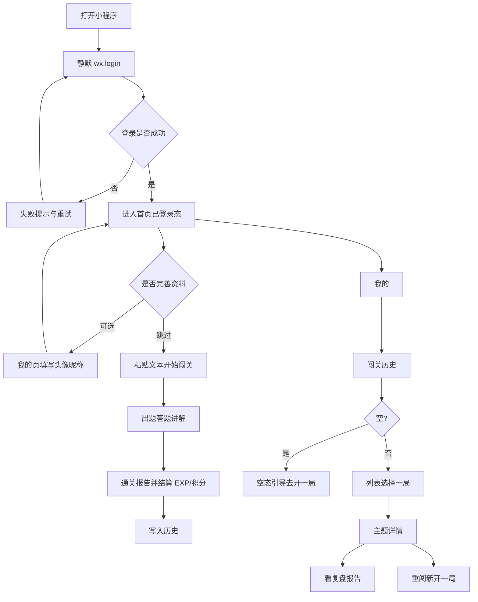

# 用户系统需求分析文档

> 产品名：**衰衰闯关**（任意知识闯关学习助手）  
> 形态：微信小程序｜市场：中国｜语言：默认中文  
> 依据：[`docs/需求分析文档.md`](./需求分析文档.md) v2.1、[`UI原型/02-mvp-history-share.html`](../UI原型/02-mvp-history-share.html)、人工确认口径（2026-11-10）  
> 版本：v1.0（已确认）｜日期：2026-11-10  
> 说明：本文**仅描述本期用户系统及相关功能的需求范围、规则与分批优先级**；技术方案见 [`用户系统方案设计文档.md`](./用户系统方案设计文档.md)。

---

## 1. 文档目标

在 Phase 0 核心闯关（文本开局 → 出题 → 答题讲解 → 报告）已打通的前提下，补齐「账号身份 + 学习数据持久化 + 用户侧回看/成长」能力，使学习记录与账号绑定，并可在「我的」中回看历史、重闯、查看等级与积分。

---

## 2. 已确认约束（人工拍板）

| 项 | 结论 |
|----|------|
| 登录方式 | **静默登录**：打开小程序后后台自动 `wx.login`，建立服务端用户身份；**无游客模式** |
| 未登录 | **不允许闯关**（出题/答题主路径必须已登录） |
| 昵称 / 头像 | 静默登录**拿不到**；需用户主动完善（见 §3） |
| 分享 | **本期不做**（海报分享、好友落地、同闯对比均不做） |
| 成长体系 | **只做** EXP / 积分 / 等级展示与通关结算；兑换、皮肤、商业化一律不做 |
| 题库 Tab | **仅 UI 占位**，无真实导入/题库逻辑 |
| 数据库 | **MySQL**（不用 SQLite） |
| 微信凭证 | 写入 `.env` 占位项，由人工自行填写真实值 |
| 续玩 / 文档导入 / 错题重练等 | 按扩展项，**本期不做** |
| UI | 用户相关页面以 `UI原型/02-mvp-history-share.html` 为准；因取消游客与分享，原型中对应屏需按本文裁剪使用（见 §6） |

---

## 3. 微信登录与资料：官方能力确认

依据微信开放文档（登录：`login.html`；头像昵称：`userProfile.html`，文档标注最近编辑 2026-06-16）：

### 3.1 静默登录能拿到什么

1. 小程序调用 `wx.login()` 得到临时 `code`（可无感调用，不必弹授权窗）。
2. 服务端用 `code` 调 `auth.code2Session`，换取 **OpenID**（及可选 UnionID）、`session_key`。
3. 据此即可在服务端建立用户体系与自定义登录态。

**结论：静默登录只能稳定拿到「是谁」（身份标识），不能拿到昵称、头像。**

### 3.2 昵称 / 头像怎么拿

- 旧接口 `wx.getUserInfo` / `wx.getUserProfile` 已回收，**不能再依赖一键拉取微信资料**。
- 现行能力为「头像昵称填写」（基础库 ≥ 2.21.2）：
  - 头像：`button` 的 `open-type="chooseAvatar"`，用户选择后拿到临时路径；
  - 昵称：`input` 的 `type="nickname"`，由用户填写（键盘可推荐微信昵称）。
- 需用户**主动点击/输入**；无法在打开小程序时静默写入真实微信昵称头像。
- 未完善前，产品应使用默认展示名与默认头像，且**不阻断**已静默登录用户的闯关。

**结论：你的理解正确——后台静默登录建立账号；昵称和头像必须用户另行授权/填写后才能真正获取并展示。**

---

## 4. 本期功能范围

### 4.1 要做（In Scope）

| 编号 | 功能 | 说明 |
|------|------|------|
| U1 | 静默登录 | 启动时自动登录；失败有可读提示与重试；成功前不可闯关 |
| U2 | 登录态维持 | 本地保存登录凭证；请求携带身份；失效则重新静默登录 |
| U3 | 用户资料完善 | 「我的」内支持选择头像、填写昵称并保存；未完善可用默认值 |
| U4 | 我的页 | 展示昵称/头像（或默认）、等级、EXP 进度、积分、累计通关数；入口含闯关历史；退出登录（语义见 §5.4） |
| U5 | 学习局绑定账号 | 出题/通关报告与当前用户绑定并写入 MySQL |
| U6 | EXP / 积分 / 等级 | 通关后按简单公式结算并展示；不做兑换 |
| U7 | 闯关历史 | 空态 + 列表（主题名、时间、状态、正确率、本局 EXP/积分增量） |
| U8 | 主题详情 | 从历史进入：看复盘报告、重闯本主题（不做分享按钮） |
| U9 | 报告回看 | 再次打开历史复盘报告 |
| U10 | 重闯 | 对已有主题再次开局答题（策略见 §5.3，待确认默认） |
| U11 | 题库 Tab 占位 | 保持示意 UI，不接真实能力 |

### 4.2 明确不做（Out of Scope）

- 游客 / 「先随便逛逛」
- 微信分享、海报、保存相册、小程序码、好友落地、正确率对比
- 积分兑换、皮肤贴纸、VIP
- 文档/网页/视频输入、真·中断续玩云同步、错题重练、讲解赞踩、题量难度档位
- RAG、排行榜、PK、语音、数字人
- 学习偏好的真实配置（原型入口可隐藏或仅示意文案，本期不实现可改配置）

---

## 5. 业务规则

### 5.1 登录与闯关门槛

1. 用户打开小程序 → 自动静默登录。
2. 登录成功前：首页「开始闯关」不可用（或点击后提示「正在登录 / 登录失败请重试」）。
3. 登录失败：展示失败原因与「重试登录」；**不得**进入出题。
4. 无独立「游客试玩」路径。

### 5.2 资料展示

1. 新用户默认昵称：**阿衰同学**；默认头像用产品占位图。
2. 用户仅在「我的」页完善昵称与头像；完善后各页问候语/「我的」头区同步更新。
3. **不强制**完善资料才能闯关；不做首次登录弹窗引导。

### 5.3 历史、报告与重闯

1. 仅持久化**已登录用户**且**已通关**的学习局；未完成局**不入库**（后置）。
2. 历史列表至少包含：主题名、时间、状态（已通关）、正确率、本局 EXP/积分增量。
3. 报告回看展示与通关报告同等结构化内容（正确率、对错数、要点、错题回顾、薄弱点）。
4. 重闯：从历史进入后重新答题；**新开一局记录**，不覆盖旧报告。  
5. **重闯出题策略（已确认）**：复用该主题已有题目，**题目顺序打乱**后再答；不重新调用 AI 出题。

### 5.4 退出登录（静默登录下的语义）

静默登录下无法真正变成「未绑定 OpenID 的游客」：同一微信用户再次静默登录仍是同一账号。

**本期已确认语义：**

- 「退出登录」= **清除本地登录凭证**（token 与本地用户缓存）；
- 清除后须重新完成静默登录，才能继续闯关；可由用户再次打开/触发登录流程完成。

### 5.5 EXP / 积分 / 等级（已锁定公式）

> 下列数字已确认锁定；不做兑换与商城。

**通关结算（仅已通关局结算一次）：**

| 项 | 公式草案 |
|----|----------|
| 本局 EXP | `40 + 正确题数 × 10` |
| 本局积分 | `round(正确率 × 40)`（正确率 0～1） |
| 累计 EXP / 积分 | 用户字段累加本局增量 |
| 等级 | `level = floor(累计 EXP / 300) + 1`（Lv.1 起） |
| 升级进度 | 当前等级内：`累计 EXP % 300` / `300` |

展示要求：

- 「我的」：Lv、EXP 进度条、积分、累计通关局数；
- 历史列表项：可展示本局 `+EXP` / `+积分`（对齐原型列表副文案，无分享相关）；
- 主题详情：展示该局正确率与本局奖励（无「生成海报并分享」）。

### 5.6 题库 Tab

继续展示占位列表与「导入题目 / 文档」示意按钮；点击可 toast「即将上线」类提示，**不接上传与出题**。

---

## 6. 与 UI 原型的对应关系

以 `UI原型/02-mvp-history-share.html` 为视觉与信息架构基准，按本期范围裁剪：

| 原型屏 | 本期 |
|--------|------|
| 微信授权登录（含「先随便逛逛」） | **不用作主路径**；改为启动静默登录（可用短暂 loading / 失败重试态，文案可保留损友风） |
| 已登录首页（问候 + 积分胶囊） | **要做**（问候用昵称或默认名） |
| 题目 · 题库 | **仅占位** |
| 学习历史空态 / 列表 | **要做** |
| 主题详情 | **要做**；去掉「生成海报并分享」 |
| 历史报告回看 | **要做**；去掉「再次生成海报分享」 |
| 我的（等级卡、历史入口、退出） | **要做**；「积分怎么用」保持示意或弱化；学习偏好可不做真功能 |
| 分享海报 / 渠道 / 好友落地 | **整段不做** |

视觉风格、文案语气、Tab（开局 / 题目 / 我的）仍对齐原型，不另行发挥。

---

## 7. 用户主流程（本期）

---

## 8. 需求批次与优先级

按依赖顺序分批；**必须按批完成并验收后再进入下一批**。优先级：P0 本期必做，同属本期但有先后。

### 批次 1｜账号底座（最高优先）

| 任务 | 验收要点 |
|------|----------|
| 静默登录打通 | 打开小程序自动登录成功；服务端有对应用户 |
| 登录态可用 | 后续请求能识别当前用户；失效可自动重登 |
| 闯关门槛 | 未登录成功不能开始闯关 |
| 环境配置 | `.env` 预留微信与 MySQL 相关项，由人工填值 |
| 我的页基础 | 能显示默认身份（默认昵称/头像），不再写「游客模式」 |

### 批次 2｜用户资料

| 任务 | 验收要点 |
|------|----------|
| 头像选择 + 昵称填写 | 按微信现行「头像昵称填写」能力 |
| 资料保存 | 刷新后「我的」与首页问候仍显示已保存资料 |
| 不强制完善 | 未填资料仍可闯关 |

### 批次 3｜闯关数据上云 + 成长结算

| 任务 | 验收要点 |
|------|----------|
| 学习局绑定用户 | 通关后该用户可在服务端查到本局 |
| 报告持久化 | 报告内容可再次读取 |
| EXP/积分/等级 | 通关后按锁定公式增加；「我的」数字正确 |

### 批次 4｜闯关历史与回看

| 任务 | 验收要点 |
|------|----------|
| 历史空态 | 无记录时文案与「去开一局」对齐原型 |
| 历史列表 | 主题名、时间、状态、正确率、奖励增量 |
| 主题详情 | 可进报告、可重闯；无分享入口 |
| 报告回看 | 与通关报告信息一致可读 |

### 批次 5｜重闯

| 任务 | 验收要点 |
|------|----------|
| 重闯开局 | 从历史发起后可重新答题 |
| 新局入库 | 完成后另记一笔历史与报告，不覆盖旧局 |
| 再次结算 | 新通关局正常加 EXP/积分 |

### 批次 6｜体验收口

| 任务 | 验收要点 |
|------|----------|
| 退出登录 | 清除本地凭证；未重新登录前不可闯关 |
| 题库 Tab | 仍为占位，无误导成真功能 |
| 文案与空失败态 | 登录失败、资料保存失败、历史加载失败有可读提示 |
| 回归 | Phase 0 主路径在「必须登录」前提下仍可完整走通 |

---

## 9. 已确认决策（v1.0 锁定）

| # | 议题 | 结论 |
|---|------|------|
| 1 | 重闯出题 | 复用旧题，**题目顺序打乱**；不重新 AI 出题 |
| 2 | 未完成局 | **只入库已通关**；未完成后置 |
| 3 | 退出登录 | **清除本地凭证** |
| 4 | EXP/积分公式 | 接受 §5.5 数字 |
| 5 | 默认昵称 | **阿衰同学** |
| 6 | 资料完善入口 | **仅「我的」页** |

---

## 10. 验收总清单（本期用户系统）

- [ ] 打开小程序自动静默登录成功  
- [ ] 登录失败可重试；未登录不能闯关  
- [ ] 无游客模式、无分享相关功能  
- [ ] 可完善并保存头像昵称；未完善有默认展示且可闯关  
- [ ] 通关后数据绑定账号并写入 MySQL  
- [ ] EXP / 积分 / 等级按公式结算并在「我的」与历史可见  
- [ ] 历史空态 / 列表 / 详情 / 报告回看可用  
- [ ] 重闯另记新局，不覆盖旧报告  
- [ ] 题库 Tab 仅占位  
- [ ] UI 对齐原型 02 中本期保留的屏幕（裁剪游客与分享）  

---

## 11. 与主需求文档的关系

| 主需求编号 | 本期用户系统 |
|------------|--------------|
| M1 / T1 微信登录 | 以**静默登录**实现，无游客 |
| M12–M14 / T20–T22 历史与重闯 | 本期做 |
| M11 / T19 微信分享 | **本期明确不做** |
| EXP/积分/等级 | 主需求未单列；按原型与人工确认纳入本期成长展示 |
| 扩展 P1+ | 仍后置 |

需求已锁定为 v1.0。实现以 [`用户系统方案设计文档.md`](./用户系统方案设计文档.md) 为准，按批次开发（后端 TDD → 前端按原型）。

---

*文档结束。v1.0 已确认。*
