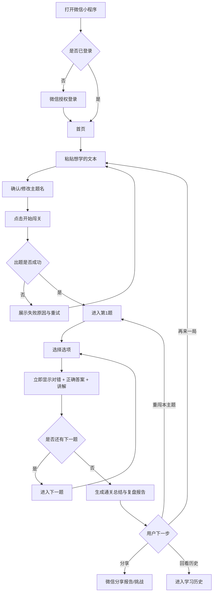
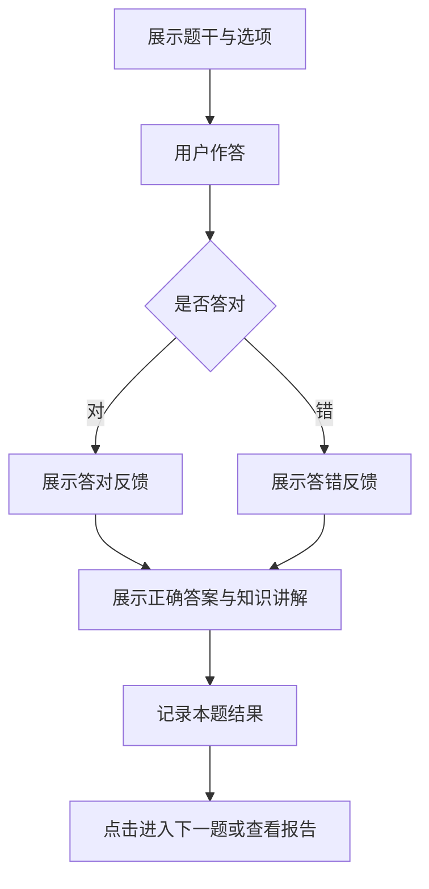
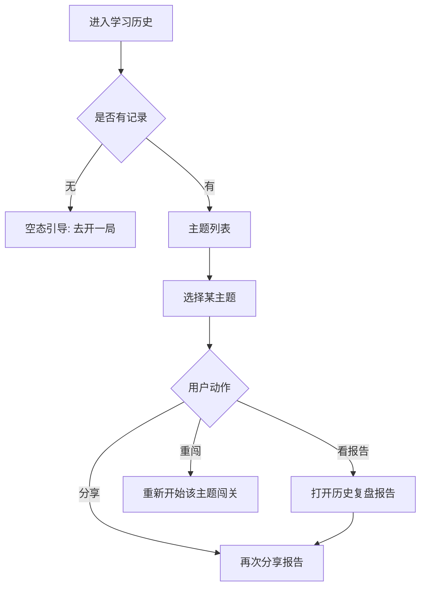
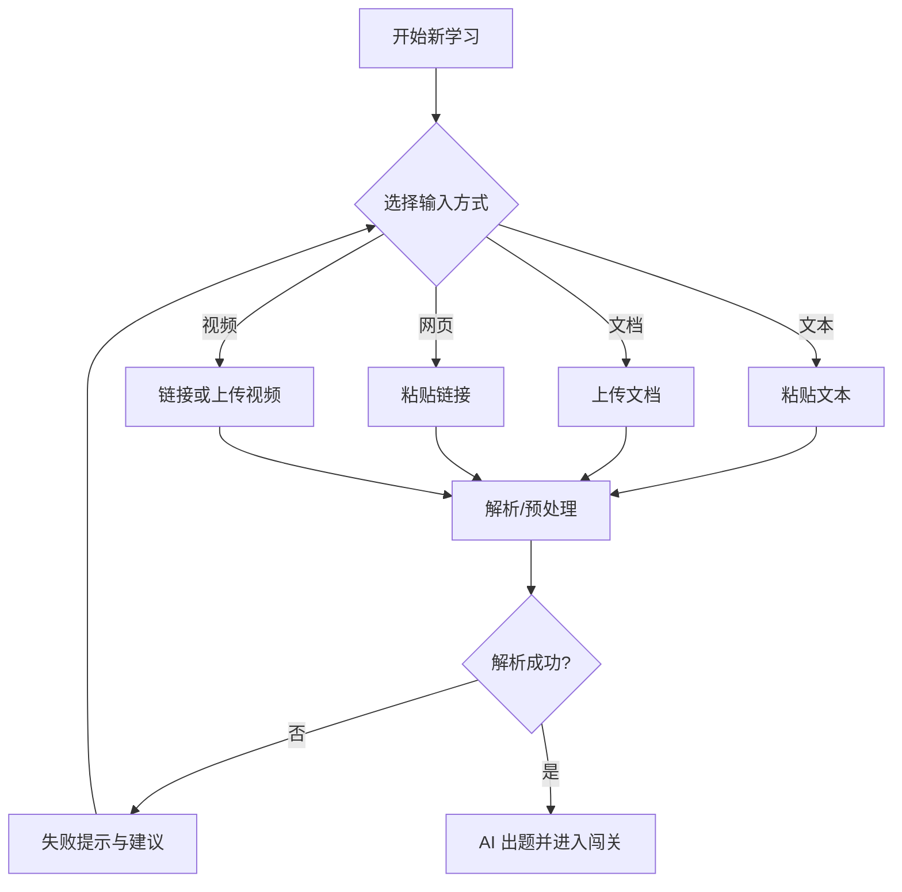
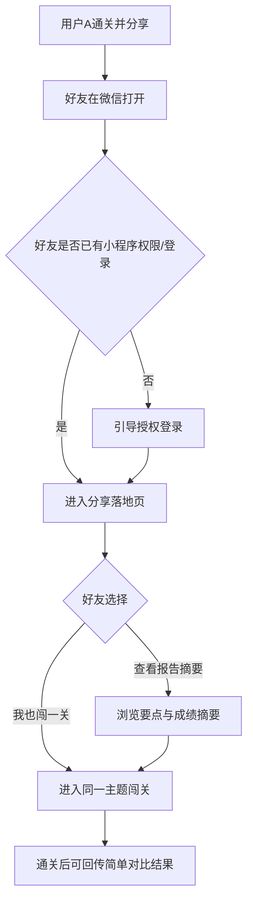

# 需求分析文档（最终版）

> 产品暂定名：**任意知识闯关学习助手**  
> 形态：微信小程序｜市场：中国｜语言：默认中文｜商业化：后置  
> 依据：`docs/需求分析文档（原始版本）.md`  
> 版本：v2.0（最终版）｜日期：2026-11-06  
> 说明：本文是可直接指导开工的最终需求口径；MVP 已按「一人可一口气做完」原则大幅收敛。

---

## 1. 需求背景

### 1.1 要解决什么问题

很多人拿到想学的内容（一段话、笔记、资料）后，往往只是「看过」——缺少主动检验，学完也没有清晰结果，更难复盘和分享。

本产品把学习变成一局可完成的闯关：

**输入知识 → AI 出题 → 边答边学（即时讲解）→ 通关总结报告 → 可分享 / 可回看**

### 1.2 为什么现在做

- 用户已习惯用 AI 辅助学习，但对话框出题缺少闯关节奏、学习档案与可分享结果。
- Quizlet、Duolingo 验证了「任意主题学习」与「游戏化坚持」；国内微信场景仍缺少轻量、完整的同形态闭环。
- 微信小程序分享路径短，适合把「通关报告」做成传播物。
- 独立开发一人全栈：必须先验证最小闭环是否成立，再扩展输入形态与社交玩法。

### 1.3 产品定位（一句话）

微信里的「任意知识闯关副本」：把用户自带的文本知识，变成一局可答题、有讲解、有报告、能回看的互动学习。

### 1.4 已确认约束

| 项 | 结论 |
|----|------|
| 目标用户 | 面向所有自学者（冷启动叙事可先聚焦大学生 / 职场资料消化） |
| 市场与语言 | 中国市场，默认中文 |
| 产品形态 | 微信小程序 |
| 团队 | 独立开发一人全栈，无设计 / 运营搭档 |
| 商业化 | 后置 |
| 全网搜知 / RAG | 后置扩展 |
| MVP 原则 | **只做最核心闭环，范围可控，争取一口气做完** |

### 1.5 本期非目标

- 不做完整网校 / 直播课 / 名师内容
- 不做权威应试题库与押题承诺
- 不做企业级知识库与班级管理系统
- 不做 VIP、排行榜、多人 PK、数字人等复杂能力（均列入扩展）

---

## 2. MVP 最小可行功能点

> **MVP 目标：** 用户只用「粘贴一段文本」，就能完整走通「出题 → 闯关 → 讲解 → 报告 → 回看」；一个人能集中做完并上线验证。  
> **刻意不做进 MVP：** 文档 / 网页 / 视频输入、续玩、复杂分析、好友同闯、RAG、生图、VIP 等。

### 2.1 MVP 一句话范围

**文本输入 → AI 生成选择题闯关 → 逐题即时反馈与讲解 → 通关复盘报告（可分享）→ 学习历史回看**

### 2.2 功能清单（仅这些）

#### A. 开始学习

| 编号 | 功能点 | 验收标准 |
|------|--------|----------|
| M1 | 微信登录 | 用户可授权登录；学习数据与账号绑定 |
| M2 | 文本输入开局 | 支持一句话 / 一段话 / 长文本粘贴；可开始生成 |
| M3 | 主题命名 | 自动生成学习主题名；允许用户修改后再开局 |
| M4 | 生成等待反馈 | 出题过程有明确 loading / 进度提示；失败可重试 |

#### B. 闯关答题

| 编号 | 功能点 | 验收标准 |
|------|--------|----------|
| M5 | AI 自动出题 | 基于用户文本生成一组选择题（建议默认 5～10 题，固定或少量档位即可） |
| M6 | 逐题闯关 | 一次一题；显示进度（如 3/8） |
| M7 | 即时反馈 | 选完立刻显示对错、正确答案、知识讲解（答错也必须有讲解） |
| M8 | 进入下一题 | 看完反馈后再进入下一题，禁止无反馈连刷 |

#### C. 通关结果

| 编号 | 功能点 | 验收标准 |
|------|--------|----------|
| M9 | 知识总结 | 通关后给出结构化要点总结 |
| M10 | 复盘报告 | 至少包含：正确率、答对/答错题数、错题回顾、薄弱点简述 |
| M11 | 微信分享 | 可将报告卡片或挑战邀请分享给好友 |

#### D. 回看复盘

| 编号 | 功能点 | 验收标准 |
|------|--------|----------|
| M12 | 学习历史 | 可看到历史主题列表、完成状态、时间 |
| M13 | 报告回看 | 可再次打开历史报告 |
| M14 | 重闯同一主题 | 可对已生成主题重新再闯一局（重新答题即可，不必很复杂） |

#### E. 基础体验

| 编号 | 功能点 | 验收标准 |
|------|--------|----------|
| M15 | 首次引导 | 一屏说清「粘贴内容 → 闯关学习」 |
| M16 | 空态 / 失败态 | 无历史、文本过短、生成失败时有可读提示与下一步建议 |

### 2.3 MVP 业务规则

1. **材料优先：** 题目与讲解尽量基于用户输入文本，不强行外扩全网知识。  
2. **讲解必出：** 无论对错，都必须给正确答案 + 讲解。  
3. **报告是终点之一：** 通关后必须能看到总结与报告，而不是只显示分数。  
4. **失败可解释：** 任何失败都要告诉用户发生了什么、可以怎么做。

### 2.4 MVP 明确不做

- 文档上传、网页链接、视频解析  
- 中断续玩（中途退出可下次重开，不强制断点续答）  
- 错题本专项训练、趋势图表等复杂分析  
- 被分享者深度同闯对比、排行榜、PK  
- RAG / 全网搜索 / AI 生图 / 语音读题 / 数字人 / VIP  

### 2.5 MVP 成功标准（验证用）

| 指标 | 含义 |
|------|------|
| 通关完成率 | 开始答题后完成全部题目的比例 |
| 分享率 | 通关用户中产生分享的比例 |
| 二次开局率 | 回访后再次提交新文本开局的比例 |
| 讲解有用感知 | 可用简单点赞/点踩粗测 |

---

## 3. 后续可以做的扩展功能点（含优先级）

> 优先级说明：P1 贴近主闭环增强；P2 扩大输入与留存；P3 社交竞技与商业化；P4 远期体验升级。

### 3.1 P1｜闭环增强（MVP 验证通过后优先）

| 编号 | 功能点 | 说明 |
|------|--------|------|
| E1 | 文档输入 | 支持 PDF / Word 等常见文档上传并出题 |
| E2 | 中断续玩 | 未完成闯关可保存进度并继续 |
| E3 | 错题重练 | 从历史中单独重做错题 |
| E4 | 讲解反馈 | 对讲解点赞 / 点踩，便于后续调优 |
| E5 | 轻量好友同闯 | 分享后好友可开同一主题；可看简单正确率对比 |
| E6 | 题量 / 难度档位 | 用户可选手动档位（如 5/10 题，简单/标准） |

### 3.2 P2｜输入扩展与学习资产

| 编号 | 功能点 | 说明 |
|------|--------|------|
| E7 | 网页链接输入 | 粘贴网址，解析正文后出题 |
| E8 | 视频输入 | 视频链接或上传，提取内容后出题 |
| E9 | 主题书架化 | 历史做成「知识书架」资产感呈现 |
| E10 | 错题种子补考 | 答错知识点自动生成「补考副本」 |
| E11 | 30 秒知识胶囊 | 将总结压缩为更易转发的短卡片 |
| E12 | 检验 / 探索双模式 | 有材料检验 vs 一句话探索，预期分开 |

### 3.3 P3｜知识增强、社交与商业化

| 编号 | 功能点 | 说明 |
|------|--------|------|
| E13 | RAG 知识库 | 上传专有资料库生成题目（企业培训 / 专项复习） |
| E14 | 全网或指定源取知 | 补强「一句话开题」的材料质量 |
| E15 | AI 生图 | 题目 / 选项配图（如单词场景） |
| E16 | 排行榜 | 主题或周期榜单 |
| E17 | 多人 PK | 实时或异步对战 |
| E18 | AI 镜像 PK | 与「模拟的我」或 AI 对手对战 |
| E19 | VIP 盈利 | 次数、高级报告、导出等（商业化阶段） |

### 3.4 P4｜远期体验

| 编号 | 功能点 | 说明 |
|------|--------|------|
| E20 | 语音读题 | 听题模式 |
| E21 | 数字人讲解 | 形象化讲解体验 |

### 3.5 扩展优先级总览

```text
P1  文档输入 / 续玩 / 错题重练 / 讲解反馈 / 轻量同闯 / 题量档位
P2  网页 / 视频 / 书架 / 补考副本 / 知识胶囊 / 双模式
P3  RAG / 全网取知 / 生图 / 排行榜 / PK / VIP
P4  语音读题 / 数字人
```

---

## 4. 用户操作的具体流程图

### 4.1 MVP 主流程（一次完整学习）



### 4.2 答题单题细节流程



### 4.3 学习历史回看流程



### 4.4 扩展期：多类型输入开局（非 MVP）



### 4.5 扩展期：分享回流（非 MVP 完整版，MVP 可先做分享发出）



---

## 5. 需求功能核对清单（Task 任务列表）

> 用法：开发或验收时直接勾选。`- [ ]` 未完成，`- [x]` 已完成。

### 5.1 MVP 核对清单（必须全部完成才算 MVP 交付）

#### 账号与基础

- [ ] **T1** 支持微信登录，学习数据与用户绑定
- [ ] **T2** 首次进入有一屏引导（粘贴内容 → 闯关学习）
- [ ] **T3** 无学习历史时有空态引导
- [ ] **T4** 文本过短 / 生成失败时有明确错误提示与重试入口

#### 开局与出题

- [ ] **T5** 支持粘贴一句话、一段话或长文本并提交
- [ ] **T6** 自动生成主题名，且允许用户修改
- [ ] **T7** 出题过程有 loading / 等待反馈
- [ ] **T8** 能基于用户文本生成一组中文选择题
- [ ] **T9** 每题包含：题干、选项、正确答案、知识讲解

#### 闯关作答

- [ ] **T10** 逐题展示，并显示答题进度
- [ ] **T11** 选择后立即反馈对错
- [ ] **T12** 答对、答错都展示正确答案与讲解
- [ ] **T13** 必须先看反馈，才能进入下一题
- [ ] **T14** 完成全部题目后自动进入结果页

#### 通关报告与分享

- [ ] **T15** 通关后生成知识要点总结
- [ ] **T16** 复盘报告含正确率、对错题数量
- [ ] **T17** 复盘报告含错题回顾
- [ ] **T18** 复盘报告含薄弱点简述
- [ ] **T19** 支持将报告或挑战分享到微信

#### 历史回看

- [ ] **T20** 可查看历史学习主题列表（主题名、状态、时间）
- [ ] **T21** 可再次打开历史复盘报告
- [ ] **T22** 可对已有主题发起重闯

#### MVP 体验底线

- [ ] **T23** 新用户约 1 分钟内能理解如何开始
- [ ] **T24** 主路径可独立走通，不依赖扩展功能
- [ ] **T25** 文案中性鼓励，避免羞辱式反馈

### 5.2 扩展功能核对清单（按优先级，MVP 后推进）

#### P1

- [ ] **T26** 支持文档上传并生成闯关（PDF / Word 等）
- [ ] **T27** 支持未完成闯关的中断续玩
- [ ] **T28** 支持错题单独重练
- [ ] **T29** 支持对讲解点赞 / 点踩
- [ ] **T30** 支持好友打开分享后进入同一主题闯关
- [ ] **T31** 支持简单正确率对比（邀请者 vs 好友）
- [ ] **T32** 支持题量或难度档位选择

#### P2

- [ ] **T33** 支持网页链接解析出题
- [ ] **T34** 支持视频输入出题
- [ ] **T35** 学习历史支持书架化展示
- [ ] **T36** 支持由错题生成补考副本
- [ ] **T37** 支持生成可转发的短版知识胶囊
- [ ] **T38** 支持检验模式 / 探索模式分流

#### P3

- [ ] **T39** 支持 RAG 知识库出题
- [ ] **T40** 支持全网或指定源取知增强
- [ ] **T41** 支持题目 / 选项 AI 配图
- [ ] **T42** 支持排行榜
- [ ] **T43** 支持多人 PK
- [ ] **T44** 支持 AI 镜像 PK
- [ ] **T45** 支持 VIP / 商业化能力

#### P4

- [ ] **T46** 支持语音读题
- [ ] **T47** 支持数字人讲解

### 5.3 明确排除项（本期不要做进排期）

- [ ] ~~完整直播课 / 名师内容生产~~（排除）
- [ ] ~~官方应试题库授权与押题~~（排除）
- [ ] ~~复杂班级管理 / 教师排课作业系统~~（排除）
- [ ] ~~硬件设备联动~~（排除）

---

## 附录：与原始版的关键收敛说明

| 原始版口径 | 最终版调整 |
|------------|------------|
| MVP 含文本 / 文档 / 网页 / 视频 | MVP **仅文本**；其余进 P1/P2 |
| MVP 含续玩、复杂后台分析等 | MVP 只保留历史列表 + 报告回看 + 重闯 |
| 被分享者完整体验偏重 | MVP 先保证「能分享发出」；同闯对比放 P1 |
| 功能面追求完整 | 最终版优先 **一口气做完可验证闭环** |

---

*文档结束。*
